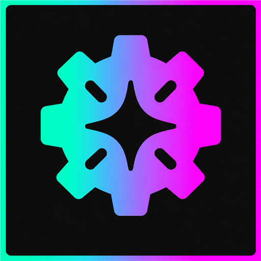

# Aetherworks



A Dalamud API 15 plugin for Final Fantasy XIV. Version 0.2.1.2 contains three independently enabled features: **Return via Teleport**, **Shared Hotbar Sync**, and **Saddlebag Withdraw All but One**.

## Saddlebag Withdraw All but One

Open `/aetherworks`, select **Saddlebag Withdraw All but One** under **Items and storage**, and turn on **Enable feature**. Right-click a saddlebag stack of two or more and choose **Withdraw all but one**. A stack of 99 withdraws 98; a stack of two withdraws one. The reserved copy lets Pandora's Entrust Duplicates button match the item when putting it back. The feature starts disabled.

Regular and premium saddlebag tabs are supported. Only the selected stack is affected; HQ/NQ remain separate. Single copies have no extra menu entry. The feature uses the game's localized Retrieve Quantity action and quantity dialog. Source changes, character/tab changes, unavailable actions and unrelated dialogs stop automatic submission. If the requested amount cannot be submitted, any opened quantity dialog remains for manual handling. Normal quantity actions stay manual. Native in-game testing, including coexistence with Pandora, remains pending.

References: [Simple Tweaks quantity dialog](https://github.com/Caraxi/SimpleTweaksPlugin/blob/main/Tweaks/UiAdjustment/CustomDefaultQuantity.cs), [native menu selection](https://github.com/Caraxi/SimpleTweaksPlugin/blob/main/Tweaks/QuickSellItems.cs), and [ECommons numeric submission](https://github.com/NightmareXIV/ECommons/blob/master/ECommons/UIHelpers/AddonMasterImplementations/InputNumeric.cs).

## Return via Teleport

Enable Aetherworks in the plugin installer, open `/aetherworks`, select **Return via Teleport** under **Actions**, and turn on **Enable feature**. The feature starts disabled, including when upgrading from older versions.

Use your normal Return button:

- If Return is ready, the game uses free Return as usual.
- If Return is on cooldown, the plugin offers a normal Teleport to your current registered home point.
- **Skip paid Teleport confirmation** off (default): show the destination and current fare, then choose Teleport or Cancel.
- **Skip paid Teleport confirmation** on: immediately Teleport at the normal fare without the Aetherworks prompt.

The fare uses the game's live destination list, including applicable discounts and free destinations. Native aetheryte ticket settings and travel restrictions still apply. An invalid or unavailable home point leaves normal Return behavior in place. No travel is queued for later.

Confirmation expires after 30 seconds and cancels if the character, territory, home point, fare or travel availability changes. Disabling the feature or changing the confirmation setting also cancels it. If Return becomes ready while the dialog is open, confirming uses free Return.

## Shared Hotbar Sync

Open `/aetherworks`, select **Shared Hotbar Sync** under **Hotbars**, and turn on **Enable feature**. It starts disabled. The first sync copies PvE assignments into PvP for every bar marked Shared in the game's Character Configuration, including shared cross hotbars. Existing PvP assignments are backed up before replacement.

After that, additions, moves and cleared slots sync in both directions. Sync history is saved separately for each character and survives job changes, plugin reloads and disabling/re-enabling the feature. Newly tracked shared bars start from PvE. Bars observed becoming unshared leave the sync history; sharing them again starts from PvE.

Different slots can be edited on either side. If the same slot changes differently on both sides, its assignments are preserved and settings offers **Keep PvE for conflicts** or **Keep PvP for conflicts**. Other slots continue syncing. A choice is discarded if those assignments change before it is applied.

Sprint is converted to the appropriate PvE/PvP Sprint action. Other assignments are copied as-is: mode-specific combat actions may be unavailable in the other mode. Macro references are copied, not macro contents. Job-specific bars, shared flags, layouts and keybinds are not changed.

Sync waits for login, area/job/mode changes and hotbar edits to settle, and pauses during combat. It compares live and saved assignments before writing. Failed writes pause the feature and attempt to restore the prior assignments; disable/re-enable to retry after checking the error. Unreadable sync history stops syncing instead of silently starting over.

State and backups live in `shared-hotbars` inside Aetherworks' plugin configuration directory. Character filenames use a hash. `backups/<character>/initial-*.json` preserves initial copies; `last-change.json` holds the most recent before-sync assignments. These files are local only and are excluded from release packages. Do not delete the state file to reset an error: doing so makes the next sync initialize from PvE again.

## Settings

The Pandora-inspired interface has a searchable feature list grouped by category on the left, with the selected feature's description, toggle and settings on the right.

The former ownership, glamour, crafting, duplicate-deposit, targeting, cast-cancel and dismount features have been removed. No background inventory tracking remains. The plugin no longer depends on KamiToolKit. Existing ownership files are left untouched and are no longer read.

## Build and validation

Requires .NET 10 and installed Dalamud API 15 development references.

```powershell
./tools/build.ps1 -Version 0.2.1.0
python -m unittest discover -s tests -p 'test_*.py' -v
python tools/package_release.py --tag v0.2.1.0 --changelog-file docs/changelog.md
python tools/check_package.py --tag v0.2.1.0
```

Packaging creates a local release archive and updates the source feed; only publish that feed with its corresponding release. Only declared runtime dependencies are included, so stale build outputs cannot reintroduce removed components.

Logic and package checks do not establish native game compatibility. Follow [in-game acceptance checks](docs/first-test.md) before relying on the feature. See [publishing](docs/publishing.md) for the existing release workflow.

This is an independent community plugin with AI-assisted development.
